# E2.3 prop quality benchmark

Review each 1× image first. Then inspect the shape and material transitions at 4×.

| Design | Final 1× | Flat 1× | Silhouette 1× | Final 4× |
| --- | --- | --- | --- | --- |
| Compact rectangular supply chest |  |  |  | 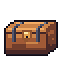 |
| Domed-lid fantasy chest |  | 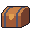 |  | 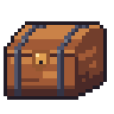 |
| Reinforced travel chest |  | 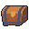 |  | 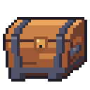 |
| Reinforced wooden crate |  |  |  | 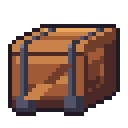 |
| Fantasy wooden barrel · wide |  |  |  |  |
| Fantasy wooden barrel · tall |  |  |  | 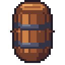 |

## Seed 42 before and after

| Baseline 1× | Domed 1× | Baseline 4× | Domed 4× |
| --- | --- | --- | --- |
|  |  |  |  |

Baseline PNG SHA-256 · `a179df270c7c02cd88c28787253bcfd43d6fca6d281e6482a7822ae342fd72e0`

## E2.1/E2.2 compared with E2.3

| Design | Before 1× | After 1× | Before 4× | After 4× |
| --- | --- | --- | --- | --- |
| Compact rectangular supply chest |  |  | 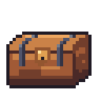 |  |
| Domed-lid fantasy chest |  |  | 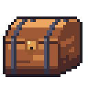 |  |
| Reinforced travel chest |  |  | 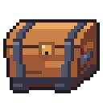 |  |
| Reinforced wooden crate |  |  | 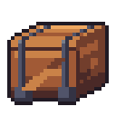 |  |

## Game context at 1×

| Design | Light ground | Dark ground | 96×64 tile scene | Locked palette 1× |
| --- | --- | --- | --- | --- |
| Compact rectangular supply chest |  |  | 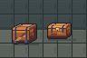 |  |
| Domed-lid fantasy chest | 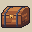 |  | 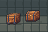 |  |
| Reinforced travel chest | 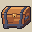 |  | 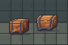 |  |
| Reinforced wooden crate | 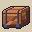 |  | 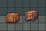 |  |
| Fantasy wooden barrel · wide |  |  | 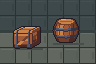 |  |
| Fantasy wooden barrel · tall |  |  | 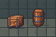 |  |

## Palettes and evidence

Authored ·  · #201a24 · #4a2927 · #723e2c · #a15a36 · #ca8248 · #eea761 · #343344 · #51546a · #777d8b · #935630 · #e0a051 · #ffe3a0

Studio locked ·  · #1c2434 · #536da0 · #f7ba5b · #eaf1f7

- Compact rectangular supply chest · [shape configuration](compact-spec.json) · [technical diagnostics](compact-qa.json)
- Domed-lid fantasy chest · [shape configuration](domed-spec.json) · [technical diagnostics](domed-qa.json)
- Reinforced travel chest · [shape configuration](travel-spec.json) · [technical diagnostics](travel-qa.json)
- Reinforced wooden crate · [shape configuration](crate-spec.json) · [technical diagnostics](crate-qa.json)
- Fantasy wooden barrel · wide · [shape configuration](barrel-wide-spec.json) · [technical diagnostics](barrel-wide-qa.json)
- Fantasy wooden barrel · tall · [shape configuration](barrel-tall-spec.json) · [technical diagnostics](barrel-tall-qa.json)

[Owner review sheet](review.md)
