# E2.4 prop review

Start at 1×. Inspect 4× only for clusters and outlines. The native scene pixels and sprite pixels have the same scale.

| Prop | Authored 1× | Locked 1× | Authored 4× | Locked 4× | Evidence |
| --- | --- | --- | --- | --- | --- |
| Compact Chest |  |  | 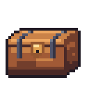 | 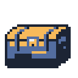 | [Spec](compact-spec.json) · [QA](compact-qa.json) |
| Domed Chest | 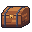 |  |  | 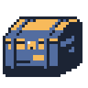 | [Spec](domed-spec.json) · [QA](domed-qa.json) |
| Travel Chest | 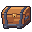 |  |  |  | [Spec](travel-spec.json) · [QA](travel-qa.json) |
| Crate |  |  | 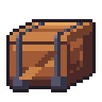 | 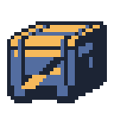 | [Spec](crate-spec.json) · [QA](crate-qa.json) |
| Barrel Wide | 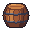 |  |  |  | [Spec](barrel-wide-spec.json) · [QA](barrel-wide-qa.json) |
| Barrel Tall |  |  | 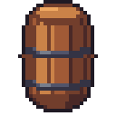 |  | [Spec](barrel-tall-spec.json) · [QA](barrel-tall-qa.json) |

## Refinements against E2.3

The before/after images use identical backgrounds and the same 32×32 canvas.

| Prop | Before 1× light | After 1× light | Before 1× dark | After 1× dark |
| --- | --- | --- | --- | --- |
| Travel Chest | 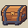 |  | 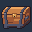 | 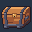 |
| 4× nearest-neighbor | [Before Travel Chest](travel-before-4x.png) | [After Travel Chest](travel-4x.png) |  |  |
| Barrel Wide |  | 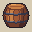 | 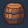 | 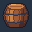 |
| 4× nearest-neighbor | [Before Barrel Wide](barrel-wide-before-4x.png) | [After Barrel Wide](barrel-wide-4x.png) |  |  |
| Barrel Tall | 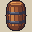 | 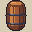 | 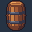 | 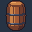 |
| 4× nearest-neighbor | [Before Barrel Tall](barrel-tall-before-4x.png) | [After Barrel Tall](barrel-tall-4x.png) |  |  |

## Three game scenes at 1×

The bottom-center pivot uses one row below the last opaque pixel. Each scene aligns every pivot to its ground row. Outdoor includes the 32×32 traveler for scale.

| Scene | Authored | Studio locked | Layout |
| --- | --- | --- | --- |
| Outdoor RPG | 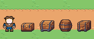 | 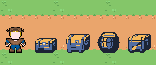 | [Layout](outdoor-layout.json) |
| Dark dungeon storage | 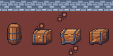 | 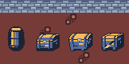 | [Layout](dungeon-layout.json) |
| Neutral comparison | 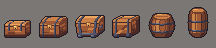 | 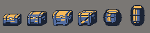 | [Layout](neutral-layout.json) |

## Palette validation

| Prop | Authored | Studio locked | Wood tones | Iron tones | Midtone gap |
| --- | --- | --- | --- | --- | --- |
| Compact Chest | FULL_RAMP | PALETTE_LIMITED | 3/5 | 2/3 | 0 vs 17 |
| Domed Chest | FULL_RAMP | PALETTE_LIMITED | 3/5 | 2/3 | 0 vs 17 |
| Travel Chest | FULL_RAMP | PALETTE_LIMITED | 3/5 | 2/3 | 0 vs 17 |
| Crate | FULL_RAMP | PALETTE_LIMITED | 3/5 | 2/3 | 0 vs 17 |
| Barrel Wide | FULL_RAMP | PALETTE_LIMITED | 3/5 | 2/3 | 0 vs 17 |
| Barrel Tall | FULL_RAMP | PALETTE_LIMITED | 3/5 | 2/3 | 0 vs 17 |

Technical validity and palette warnings are recorded independently. Artistic status stays **PENDING_HUMAN_REVIEW**.

 · [Proposed preset](wood-iron-preset.json)

 · #1c2434 · #536da0 · #f7ba5b · #eaf1f7

[Owner review sheet](review.md)
