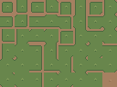
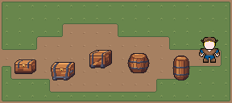
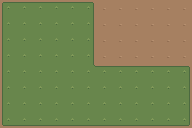
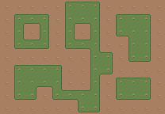
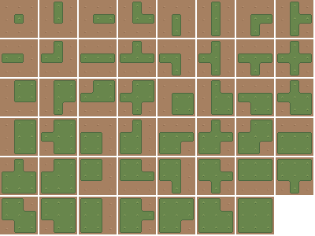

# E3.1 Grass & Dirt Tileset

Native-size previews come first. The atlas contains 47 grass configurations on a dirt field and Dirt Center in slot 48.

| Preview | Native size | 4× inspection |
| --- | --- | --- |
| Atlas |  | [View 4×](atlas-4x.png) |
| Repeated centers |  | [View 4×](repeated-centers-4x.png) |
| Outdoor and E2 props |  | [View 4×](outdoor-4x.png) |
| Horizontal and vertical transitions |  | [View 4×](transition-4x.png) |
| Corner stress map |  | [View 4×](stress-4x.png) |

[Atlas mapping and spec](atlas.json) · [Locked atlas](locked-atlas.png) · [Locked transition](transition-locked-1x.png)

[Mask coverage](coverage.json) · [Technical diagnostics](qa.json) · [Owner review](review.md)
