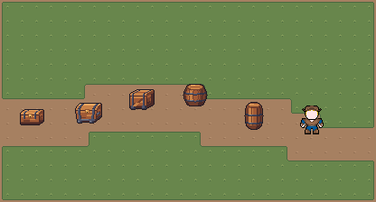
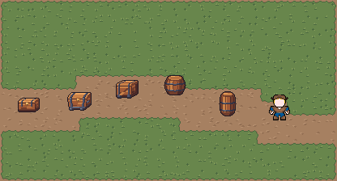
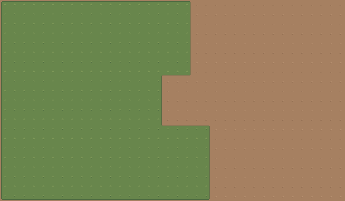
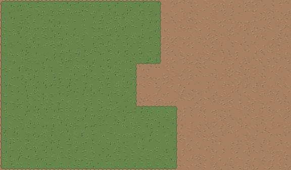
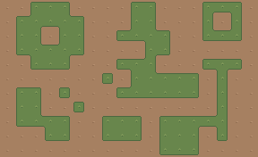
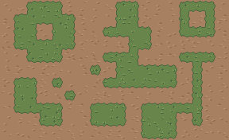
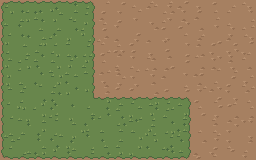
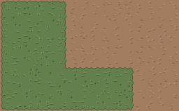
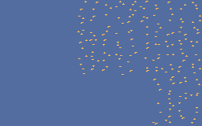
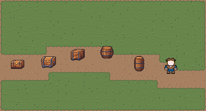

# E3.2 Terrain Art Quality

Review 1× before 4× nearest-neighbor. A, B and C keep the same layouts and placements across E3.1 and E3.2.

| Scene | E3.1 at 1× | E3.2 at 1× | 4× |
| --- | --- | --- | --- |
| Outdoor RPG with E2 props |  |  | [Before](outdoor-before-4x.png) · [After](outdoor-after-4x.png) |
| Large grass and dirt |  |  | [Before](large-before-4x.png) · [After](large-after-4x.png) |
| Autotile stress |  |  | [Before](stress-before-4x.png) · [After](stress-after-4x.png) |

## Palette and density comparisons

| Scene D palette | Native | Enlarged |
| --- | --- | --- |
| authored |  | [4×](palette-authored-4x.png) |
| project |  | [4×](palette-project-4x.png) |
| locked |  | [4×](palette-locked-4x.png) |

| Outdoor density | Native | Enlarged |
| --- | --- | --- |
| sparse |  | [4×](outdoor-sparse-4x.png) |
| standard |  | [4×](outdoor-after-4x.png) |
| dense |  | [4×](outdoor-dense-4x.png) |

[Project palette](project-palette.json) · [Atlas PNG](atlas.png) · [Atlas 4×](atlas-4x.png) · [Mask mapping](atlas.json)

[Scene metadata](scenes.json) · [Seam, corner and repetition QA](qa.json) · [Owner review sheet](review.md)
