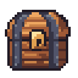
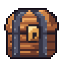

# Fantasy Adventurer Supply Chest

A compact wooden supply chest with dark iron reinforcements, readable lock, controlled warm lighting and a clear silhouette suitable for a 2D adventure game.

Inspect the final at 1× first. Use 4× to inspect the outlines, wood clusters, and iron bands over light and dark backgrounds.

| Seed | Flat 1× | Silhouette 1× | Final 1× | Final 4× |
| --- | --- | --- | --- | --- |
| [42](chest-42.json) |  |  |  |  |
| [43](chest-43.json) |  |  |  |  |

## Palette and diagnostics

Engine palette · `#201a24` · `#4a2927` · `#723e2c` · `#a15a36` · `#ca8248` · `#eea761` · `#343344` · `#51546a` · `#777d8b` · `#935630` · `#e0a051` · `#ffe3a0`

Seed 42 has wider-set iron bands. Seed 43 moves both bands inward and shifts the latch one pixel right.

Technical QA checked RGBA size, binary alpha, zero transparent RGB, palette, frame metadata, PNG round-trip and determinism.

- [Seed 42 technical diagnostics](qa-42.json)
- [Seed 43 technical diagnostics](qa-43.json)

Artistic review · **PENDING_HUMAN_REVIEW**
