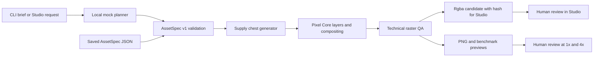

# Architecture

AssetSpec v1 is a strict JSON object. The schema requires version, kind, display name, canvas, seed, ordered layers, palette, light direction and the prop extension. The current prop extension identifies the supply-chest design. Canvas is 32×32, seed is an unsigned 32-bit integer, and layer order is body, lid, iron, lock. The default light is upper-left. The schema normalizes palette hex to lowercase and reports validation errors by field path.

A future asset kind can introduce its own validated extension and generator while sharing the canvas, palette, frame and provenance concepts. Extend the discriminant when the second kind needs it. The current single-frame slice gets HTTP duration and loop from the frozen request, with a standard 100 ms non-looping frame for the CLI.

Pixel Core draws geometric shapes by sampling integer raster cells. Filled contours, spans and material ramps supply the chest's outlines and surface details. Layers composite in RGBA8 with alpha 0 or 255. Transparent pixels are all zero. Palette locking maps each material role to the nearest opaque ink before drawing. Export writes RGBA PNG and the benchmark scales the final raster using nearest-neighbor.

The jobs module owns candidate lifecycle and request receipts. Studio HTTP validates the incoming wire shape, converts colors and optional masks, and serves the QA-checked raster. The DeepSeek scaffold shares the planner interface and exercises response validation and cost accounting with injected test replies. Real calls are disabled with a limit of zero. Its configuration checks for the presence of an environment key and keeps the key out of usage records.
