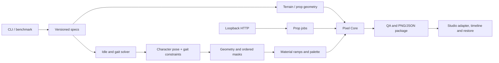

# R0 · Audit dự án và chuẩn bị R&D

**R0_CLEANUP_READY_FOR_RND**

Engine dựng prop, terrain, nhân vật và animation từ spec đã kiểm tra, chạy trên máy cục bộ. Audit giả định một người phát triển chạy CLI hoặc Studio qua loopback. E5.2 engineering đã được Project Owner chấp nhận. W2 Expressive Walk là baseline R&D, W1 Conservative Walk là đối chứng, và Walk Game-Ready Final Acceptance vẫn chờ duyệt. [W2 và W1](../benchmarks/results/e52/README.md) · [Lộ trình R&D](../research/open-source/README.md)

## Git và checkpoint

- Nhánh gốc `codex/e5-2-walk-cycle` sạch tại `ea62de7`. R0 dùng nhánh riêng `codex/e5-rnd-cleanup` với checkpoint đó là cha. `origin` trỏ GitHub. Hai merge E2 và E3 nằm trên lịch sử có nhánh, nên ancestry được kiểm theo quan hệ tổ tiên của từng checkpoint.
- Cả 18 checkpoint từ bootstrap E0/E1 `368c8eb` đến E5.2 `ea62de7` đều là tổ tiên của điểm bắt đầu. Báo cáo R0 dùng kết quả chạy lại **65 Engine tests** thay cho số 62 trong brief.
- Các benchmark, manifest, shape lock, spec v1/v2 của E5 và fixture Studio lịch sử vẫn được Git lưu. 805 dòng SHA-256 ở tám catalog E3–E5.2 khớp, cùng 22 digest prop ở mức PNG hoặc RGBA theo QA gốc. [Kết quả regression](r0-regression.md) · [Catalog lịch sử](README.md#milestone-archive)

## Source đang được sử dụng

Đồ thị đọc import, re-export, type import và import literal bằng TypeScript compiler. Điểm vào lấy từ package scripts, CLI, server và 18 tệp test. Theo dấu được toàn bộ 115 tệp TypeScript gồm 63 tệp source, 34 script và 18 test qua 513 cạnh nội bộ, từ 53 điểm vào. 60 tệp source thuộc luồng CLI/server, gồm cả khai báo kiểu. Năm script dùng dynamic import tới Studio được đọc riêng. Graphify cục bộ có 200 node, chủ yếu phản ánh kiến trúc giai đoạn đầu. Kết luận reachability dùng đồ thị TypeScript hiện tại và kiểm đường gọi bằng tay.

| Khu vực | Đường gọi và vai trò |
| --- | --- |
| Pixel Core, geometry, materials, palette | Các generator dùng geometry, raster, color mapping và compositor chung. `pngjs` đi qua một module encode/decode. [Pixel Core](../src/core) · [Kiến trúc Engine](architecture/overview.md) |
| Props và API | CLI `generate` và HTTP `serve` chạy các preset chest/crate/barrel qua dispatcher. Legacy chest vẫn dùng cho Seed 42/43 và spec v1. [Prop dispatcher](../src/generators/props/render.ts) · [Studio contract](integration/studio-adapter.md) |
| Terrain | CLI, bake, gallery và Studio test dùng TerrainSpec v1–v4, atlas, world-space bake và verifier. Các vị trí đưa vào Studio vẫn dùng atlas/mask canonical. [Terrain CLI](../src/cli/terrain.ts) · [Studio terrain](integration/studio-terrain-production.md) |
| Character | CLI và production verifier dùng CharacterSpec, solver, ordered masks và material render. Shape lock lưu alpha và lineage riêng cho từng revision. [Character production](architecture/character-production.md) |
| Animation | CLI, benchmark và Studio test gọi AnimationSpec v1/v2, `buildAnimation`, idle/gait, kiểm frame và strip export. [Walk model](architecture/e52-walk-motion.md) |
| Studio, quality và tests | HTTP chỉ quảng cáo prop. Character, terrain và animation dùng các gói PNG/JSON cùng script tích hợp động với checkout Studio. DeepSeek scaffold dùng fixture trong test chi phí và timeout. [Studio integration](integration/e52-walk-studio.md) · [Quality suites](../tests) |

## Sức khỏe kiến trúc và các mục cần quyết định

| Mức | Phát hiện | Cách xử lý sau R0 |
| --- | --- | --- |
| Trước khi phân phối | Repo chưa có tệp license cấp dự án. Metadata dependency và nguồn fixture được ghi riêng. | Chốt giấy phép của dự án và kiểm provenance theo từng nguồn trước khi chia sẻ thêm mã hoặc tài sản. [Nguồn fixture E2.4](../benchmarks/fixtures/e24/README.md) |
| Trước khi đổi gait | `solveWalkPose` đưa joint và `GaitPose` vào cùng character renderer. `buildWalkAnimation` vẫn gắn với v2 giữ đèn và far-foot bridge. | Thử nghiệm có thể chạy từ spec v2 bên ngoài production. Solver ngoài phạm vi v2 cần adapter nghiên cứu và quyết định schema trước khi tích hợp. [Walk solver](../src/generators/character/walk-pose.ts) · [Walk builder](../src/generators/character/walk.ts) |
| Trước khi chạy trong game | Root E5.2 đồng bộ theo frame. Studio giữ timing tag, còn root/contact nằm trong sidecar. | Kiểm bước đổi frame, pivot, root tích lũy và chân planted trong game. Studio nhập PNG trực tiếp dùng 100 ms/frame, nên giữ JSON trong đường production. [Studio E8 backlog](integration/e52-walk-studio.md) |
| Trước khi chạy batch chung | Một số benchmark cũ dùng `writeFile` vào `--out`. Guard chỉ bảo vệ các edition được liệt kê. Export gói character dừng ở thư mục dở dang nếu ghi lỗi giữa chừng. | Chạy thử ở thư mục mới trong `run/`. Đánh giá thêm guard cho archive và ghi gói theo bước xác nhận toàn bộ nếu quy trình chạy đồng thời cần chúng. [Ví dụ benchmark E2](../scripts/benchmark-e2.ts) · [Character export](../src/generators/character/export.ts) |
| Trước khi nhận ảnh ngoài | `decodePng` đọc toàn bộ bộ đệm bằng decoder đồng bộ. Luồng benchmark hiện đọc fixture và gói cục bộ có nguồn rõ. | Đặt giới hạn đầu vào phù hợp ở ranh giới import khi R&D bắt đầu đọc ảnh tải về. [PNG wrapper](../src/core/renderer/png.ts) |
| Khi mở rộng QA | CI chạy unit, smoke và benchmark. Studio parity phụ thuộc checkout bên cạnh và hiện chạy cục bộ. | Pin revision Studio trong test job khi hai repo có quy trình CI chung. Dùng các ngưỡng thời gian giàu ý nghĩa trước khi tối ưu bước render lặp để xác minh determinism. [Engine CI](../.github/workflows/ci.yml) · [Regression R0](r0-regression.md) |

### Dead-code và trùng lặp

Không tìm thấy module TypeScript mồ côi sau khi tính CLI, test, script npm và import động. Các kết quả có khả năng thu hẹp chủ yếu là bề mặt export. `fixtureDir`, `hexSchema`, `seedSchema`, `assetSpecV1`, `terrainSpecV1–V4`, một số kiểu composition/diagnostic và kiểu `WalkSpec`/`WalkKey` có thể xem lại sau khi chốt phạm vi public API. Các schema vẫn thực thi nội bộ. Hai re-export animation `inspectIdleTransition` và `unpackAnimationStrip` có caller trong test và Studio. [Spec terrain](../src/specs/terrain.ts) · [Animation exports](../src/generators/character/animation.ts) · [Animation test](../tests/animation.test.ts)

Backup helper trong `studio-backup.ts` và đường kiểm terrain cũ cùng đọc manifest PXL. Đường mới còn mang resource và lịch sử. Giữ đường cũ đến khi thống nhất coverage và phạm vi tương thích. `dist/` và HTML preview tạo được từ source, nhưng các báo cáo HTML đã publish có checksum và được dùng làm fixture hoặc tài liệu tham chiếu. E5.2 đọc CSS từ report E5.1. [Backup helper](../scripts/studio-backup.ts) · [Terrain Studio test](../scripts/terrain-studio.ts) · [Report E5.2](../scripts/report-e52.ts)

## Dependencies, secrets và license

| Gói trực tiếp | Phiên bản cài | License trong package | Sử dụng |
| --- | --- | --- | --- |
| `pngjs` | 7.0.0 | MIT | Encode/decode PNG |
| `zod` | 4.6.7 | MIT | Schema và boundary validation |
| `@types/node` | 24.19.2 | MIT | Kiểu runtime Node |
| `@types/pngjs` | 6.0.5 | MIT | Kiểu decoder/encoder |
| `eslint` | 10.15.0 | MIT | Lint |
| `typescript-eslint` | 8.74.0 | MIT | Quy tắc TypeScript trong cấu hình ESLint |
| `typescript` | 5.9.3 | Apache-2.0 | Typecheck và build |

Lockfile ghi 101 dependency entries với license metadata, thuộc MIT, Apache-2.0, BlueOak-1.0.0, BSD-2-Clause, BSD-3-Clause và ISC. `npm audit` trả 0 advisory ở tất cả mức nguy cơ vào 2026-11-25. Hai dependency runtime và năm dependency phát triển đều có caller hoặc cấu hình sử dụng. [Package manifest](../package.json) · [Lockfile](../package-lock.json)

Quét mẫu credential và private path trên 406 tệp văn bản tracked, tên tệp và diff của 18 commit không tìm thấy dấu hiệu khớp. `.env.example` là template. `.env`, `.npmrc` và metadata máy được ignore. Quét mẫu không xác nhận nội dung mọi file nhị phân hoặc dữ liệu trong cache cục bộ. DeepSeek giữ trạng thái disabled và giới hạn 0 request thật. [Ignore rules](../.gitignore) · [DeepSeek scaffold](../src/providers/deepseek/scaffold.ts)

## Cleanup và tài liệu

Đã xóa từng tệp đã ignore và không tracked sau khi xác minh SHA-256 với bản archive có trong Git. Ledger ghi trạng thái, dung lượng, đường dẫn phục hồi và SHA-256 từng tệp. Có thể copy từ `RecoveryPath` về `Path` nếu cần đúng bản cũ. Các thư mục được kiểm phạm vi trước khi xóa và đường dẫn có junction bị từ chối. [Danh sách đã dọn](r0-cleanup-ledger.tsv)

| Phạm vi | Tệp trước | Byte trước | Tệp ngay sau cleanup | Byte ngay sau cleanup |
| --- | ---: | ---: | ---: | ---: |
| `.cache` | 555 | 179,414,304 | 537 | 179,395,629 |
| `benchmarks/results/run` | 2,444 | 18,573,542 | 128 | 2,332,264 |
| `dist` | 126 | 605,727 | 126 | 605,727 |
| `node_modules` | 3,584 | 49,552,102 | 3,584 | 49,552,102 |
| `graphify-out` | 24 | 410,643 | 24 | 410,643 |
| **Tổng** | **6,733** | **248,556,318** | **4,399** | **232,296,365** |

Đã xóa **2.334 tệp**, giải phóng **16.259.953 byte theo kích thước tệp, khoảng 15,51 MiB**. Điểm đo ngay sau xóa tách khỏi dữ liệu sinh lại khi chạy regression. Dung lượng di chuyển là **0 byte**. [Dung lượng sau regression](r0-regression.md)

Các bản nháp khác byte, ZIP backup Studio, log lịch sử, tài sản nguồn E2.4 trong cache và thư mục thử nghiệm Studio `.cache/terrain-studio-FvDPjE` được giữ để Project Owner xem xét riêng. `.cache/npm` giữ cache tải gói phục vụ cài đặt offline. `node_modules`, `dist` và `graphify-out` tiếp tục phục vụ bản checkout. Danh sách có 152 tệp ngoài nhóm dependency, cache npm và các hiện vật mới của lượt regression. [Danh sách cần duyệt trước khi xóa](r0-retained-inventory.tsv)

README có lối chạy nhanh và index theo milestone. HANDOFF và roadmap ghi W2 cho R&D và giữ trạng thái game-ready pending. Các liên kết nội bộ lịch sử được kiểm, và báo cáo SHA-256 cố định giữ nguyên. [Documentation index](README.md) · [Handoff](../HANDOFF.md)

R0 đủ điều kiện mở phần nghiên cứu tách biệt. Game runtime vẫn là `GAME_RUNTIME_NOT_TESTED`. Mã nguồn ngoài và phát triển DeepSeek chưa thuộc phạm vi của nhánh này. [Kế hoạch R&D](../research/open-source/README.md)
